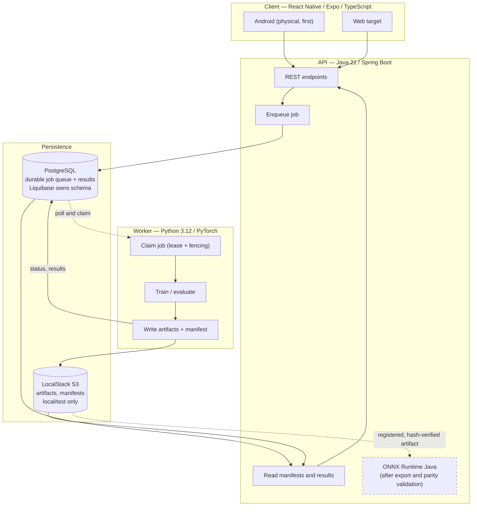

# Portfolio Lab — design

Updated 2026-09-21 after the user authorized the requirements-review corrections.

## Direction and stack

Build a mobile experiment lab around Deep Learning for Portfolio Optimization. The goal is reproducible research and demonstrable job recovery, not trading or promised investment performance.

| Layer | Selected direction |
|---|---|
| Research and worker | Python 3.12 / PyTorch |
| API | Java 21 / Spring Boot |
| Client | React Native / Expo / TypeScript; physical Android first, web target |
| Persistence | PostgreSQL / Liquibase |
| Artifact storage | LocalStack S3 locally |
| Local runtime | Docker Compose, independent of Kubernetes |
| Additional deployment | K3s, after Compose works |
| Inference extension | ONNX Runtime Java, after export/parity validation |

This replaces the old Kotlin/Quarkus direction. FastAPI and Django were discussed alternatives; neither is the selected API. Spring AI is outside current scope. Framework release pins require compatibility checks before installation; see [TOOLCHAIN.md](docs/TOOLCHAIN.md).

## Authority

### Approval and verification status

The user-approved stack is React Native/Expo/TypeScript, Java/Spring Boot, Python/PyTorch, PostgreSQL/Liquibase, LocalStack, Docker Compose and later K3s, as explicitly recorded in AGENTS.md. PostgreSQL-backed jobs, one CPU worker, frozen per-fold models, and ONNX as a later extension are reviewed engineering defaults within that direction. Approval of the stack is not evidence that unbuilt integrations pass tests.

The architecture is suitable to proceed with staged implementation. Exact library/image locks, Android/web compatibility, LocalStack authentication/persistence and ONNX parity require milestone-specific verification. No paid subscription, public license, public deployment or renewed Tailscale setup is approved by this review.

[SPEC.md](docs/SPEC.md) is the single technical contract for APIs, jobs, schema, manifests, folds, and verification. [PRD.md](docs/PRD.md) owns product stories. This document owns architecture and sequence; it deliberately does not duplicate endpoint or table definitions. Active OpenSpec deltas record planned behavior, not proof that it exists.

## Architecture

Dashed = not yet built and gated on earlier milestones. **Nothing in this diagram is
implemented today** beyond parts of the Python worker; see Current evidence below.

The two runtimes never call each other synchronously. They share a database contract and an
artifact contract, which is what makes a job recoverable after an interruption on either side.

Liquibase is the sole schema-migration owner. Python and Java share documented database/artifact contracts, not synchronous training calls. Use one CPU worker initially. S3 is artifact storage, not the job queue.

Compose must include API, worker, PostgreSQL, LocalStack, and idempotent infrastructure initialization. A synthetic dataset must support an end-to-end demo without live market data. Health checks, durable volumes, schema initialization, and startup retries are required.

After documented host prerequisites and private environment configuration, `docker compose up` must start those PC services and initialization without Kubernetes or manual database/bucket setup. The Expo app is built/installed separately on the physical Android phone; the phone is not a Compose container.

The synthetic dataset removes market-feed dependence, not vendor setup requirements: current LocalStack requires an account token, and initial downloads/authentication may need connectivity. Do not promise a fully offline first launch. Verify S3 restart persistence for the selected plan/image. See TOOLCHAIN for official-source checks.

K3s adds API/worker Deployments, Services, PostgreSQL persistence, and persistent artifact storage. LocalStack remains a local/test dependency, not a claim of production AWS equivalence. Local cluster first; paid services and public deployment are not authorized.

On this Windows PC, the planned local cluster uses k3d to run K3s in Linux containers. It is an additional deployment path with separate persistent volumes, not native Windows Kubernetes. Run Compose and K3s separately by default to conserve memory.

## Milestone ownership

| Milestone | Scope | Owner / evidence |
|---|---|---|
| A0: bounded prototype | Fixed chronological holdout, two baselines, checkpoint recovery, CPU smoke and bounded historical experiment if accessible | Existing reproduce-portfolio-learning change; partial implementation |
| A1: fuller research | Walk-forward, seven paper baselines, tier comparisons, seed/cost sweeps, CLI manifest verification, honest findings | Subsequent research implementation change; not built |
| B: distributed execution | API, durable worker jobs, Postgres/Liquibase, LocalStack, Compose; HTTP verification | Subsequent service change; not built |
| B extension | ONNX export, per-fold parity and explicit served-model selection | Required before inference endpoint ships |
| C: mobile | Android results/status, web-compatible charts, visible offline cache | Subsequent client change; not built |
| D: deployment | Additional K3s path and recovery demonstration | Subsequent deployment change; not built |

A0 completion does not imply paper replication or A1 completion. A1 can be reported independently before the application ships. Resume wording must describe measured, completed work only.

### Implementation sequence and first usable delivery

Milestone letters identify scope ownership, not a requirement to finish every research study before building a usable app. The working delivery order is:

1. Finish the bounded A0 numerical/evidence work, including a repeat-run comparison and a historical experiment or explicit sourcing limitation.
2. Implement and lock the shared run schema, retrievable inputs and minimum replay contract needed by the service. Stage this contract work from A1 ahead of its larger research studies; do not silently serve A0 v1 artifacts as v2.
3. Build a thin B slice: submit one synthetic experiment through Spring Boot, track it in PostgreSQL, run it in Python, and persist/display its report from LocalStack S3 under Compose. Demonstrate duplicate-request handling, cancellation and interrupted-worker recovery. Broader B endpoints remain unfinished until separately delivered.
4. Build a thin C slice: Android experiment submission, status, allocation/results and two-baseline comparison. Keep phone connection deferred until this is locally testable; verify private phone access when that milestone is undertaken. Web rendering/cache checks remain part of C completion.
5. Extend A1 and the B/C surfaces with walk-forward research, historical tiers, seven baselines, seed/cost comparisons, verification and the remaining product stories. Freeze each experiment protocol before examining its held-out outcome. ONNX serving is a later conditional extension.
6. Add the equivalent K3s deployment and repeat persistence/recovery checks. Package a measured demonstration, architecture explanation and honest findings for the resume.

The first usable slice is deliberately small but does not reduce any A1/B/C/D completion requirement. [READINESS.md](docs/READINESS.md) records acceptance checks and current environment gaps.

## Current evidence

The Python prototype and three test modules exist. The review ran 17 passing tests on 2026-09-21. No verified historical reproduction, API, client, Compose stack, or K3s deployment exists. [REPRODUCTION.md](docs/REPRODUCTION.md) describes current numerical deviations.

## Access and unresolved choices

Backend and training run on this PC. Tailscale is disconnected at the user's request; do not reconnect or block local work on phone enrollment. Private HTTPS phone access is a later milestone. No public Funnel.

Apache-2.0 remains a proposed license, not granted by this documentation update. Original paper inputs and the historical audit figures remain unverified. Dataset rights must be recorded before fetching or publishing relevant artifacts. Numerical defaults are explicit engineering choices, not facts about the paper.
